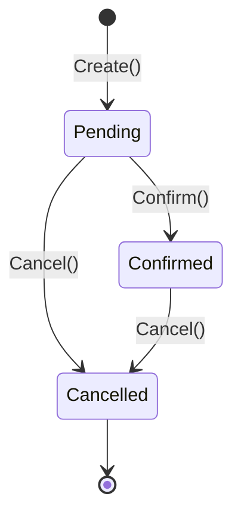
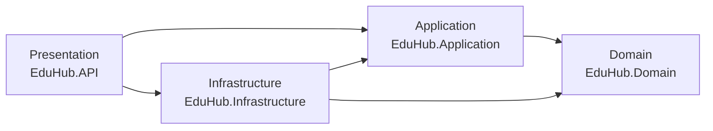

# Bài làm giữa kỳ IN4211 - EduHub

## Câu 1a

Bốn trụ cột của lập trình hướng đối tượng:

| Trụ cột | Giải thích ngắn gọn | Chỗ minh hoạ trong bài làm |
|---|---|---|
| **Đóng gói (Encapsulation)** | Gom dữ liệu và hành vi vào một lớp, che giấu trạng thái bên trong; bên ngoài chỉ thay đổi trạng thái qua các phương thức công khai đã kiểm tra hợp lệ. | `EduHub.Domain/Entities/Registration.cs`, lớp `Registration`: các thuộc tính có `private set`, constructor `private`, trạng thái chỉ đổi qua `Confirm()` và `Cancel()`. Tương tự `Member.cs`, lớp `Member`. |
| **Kế thừa (Inheritance)** | Lớp con dùng lại và mở rộng thành viên của lớp cha, tránh lặp code. | `EduHub.Infrastructure/Notifications/ConsoleNotificationServiceBase.cs`: lớp `ConsoleNotificationServiceBase` là lớp cha; `EmailNotificationService` và `SmsNotificationService` kế thừa nó, chỉ ghi đè `Channel`, còn `Send()` dùng lại của lớp cha. |
| **Đa hình (Polymorphism)** | Cùng một lời gọi nhưng hành vi phụ thuộc kiểu thực tế của đối tượng lúc chạy. | `EduHub.Application/Services/EventService.cs`, lớp `EventService`: gọi `notifier.Send(...)` trên `INotificationService`; tuỳ kênh mà thực tế chạy `EmailNotificationService` hay `SmsNotificationService`. |
| **Trừu tượng (Abstraction)** | Chỉ phơi bày "làm gì" (hợp đồng), che giấu "làm như thế nào". | `EduHub.Application/Abstractions/IEventRepository.cs` (interface `IEventRepository`) và `INotificationService.cs` (interface `INotificationService`): `EventService` chỉ biết interface, không biết lưu bằng gì, gửi bằng gì. |

## Câu 1b

Hai vấn đề của lớp `Member` chưa đóng gói:

1. **Thuộc tính có `public set` nên bên ngoài sửa trực tiếp, bỏ qua mọi kiểm tra.** Ví dụ `m.Email = "abc"` gán được một email không có `@`; `Id` cũng bị ghi đè tuỳ ý. Lớp không kiểm soát được tính hợp lệ của dữ liệu của chính nó.
2. **Constructor `public Member() { }` không tham số cho phép tạo đối tượng ở trạng thái không hợp lệ.** Sau `new Member()` thì `Email` là `null` và `Id` là `Guid.Empty`, đối tượng "nửa vời" này có thể bị đem đi dùng tiếp.

Lớp đã viết lại nằm ở `EduHub.Domain/Entities/Member.cs`: setter `private`, constructor `private`, tạo đối tượng qua factory method `Member.Create(email)` (kiểm tra email không rỗng và có ký tự `@`), đổi email qua `ChangeEmail(...)` cũng kiểm tra như vậy.

## Câu 2a



`Cancelled` là trạng thái cuối: không có mũi tên nào đi ra, nên `Confirm()` hoặc `Cancel()` trên phiếu đã huỷ đều ném `InvalidOperationException`.

## Câu 3a

Lớp `EventService` (Đoạn mã 2) vi phạm ba nguyên lý SOLID:

1. **SRP (Single Responsibility Principle), dòng 6-7, 8-9, 10 và 11-14.** Một phương thức làm cả bốn việc: kiểm tra dữ liệu (dòng 6-7), truy cập CSDL (dòng 8-9), ghi log ra tệp (dòng 10) và gửi thông báo (dòng 11-14). Lớp có nhiều hơn một lý do để thay đổi.
2. **OCP (Open/Closed Principle), dòng 11-14.** Chuỗi `if (channel == "email") ... else if (channel == "sms")` buộc phải sửa chính `EventService` mỗi khi thêm kênh mới (ví dụ Zalo, push). Lớp không "đóng với sửa đổi, mở với mở rộng".
3. **DIP (Dependency Inversion Principle), dòng 8, 10, 12 và 14.** Lớp cấp cao phụ thuộc trực tiếp vào lớp cụ thể bằng `new SqlConnection(...)` (dòng 8), `File.AppendAllText(...)` (dòng 10), `new EmailSender()` (dòng 12), `new SmsSender()` (dòng 14) thay vì phụ thuộc vào abstraction (interface) được tiêm qua constructor. Hậu quả: không thể unit test mà không đụng CSDL, tệp, email thật.

Cách khắc phục trong bài: `Event.Create(...)` giữ việc kiểm tra dữ liệu (Domain); `IEventRepository` che việc lưu trữ; `INotificationService` và `INotificationServiceFactory` che việc gửi thông báo theo kênh; `EventService` chỉ điều phối và nhận các phụ thuộc qua constructor (DI).

## Câu 4b

- **`git merge`** gộp nhánh nguồn vào nhánh đích bằng một *merge commit* (hoặc fast-forward), **giữ nguyên toàn bộ lịch sử** của cả hai nhánh. Lịch sử đúng với thực tế nhưng có thể rối vì nhiều merge commit.
- **`git rebase`** lấy các commit của nhánh hiện tại và **phát lại (replay) lên đỉnh nhánh đích**, tạo ra các commit mới (mã băm khác). Kết quả là lịch sử **tuyến tính, gọn**, nhưng **viết lại lịch sử**.

**Khi nào không nên dùng rebase:** không rebase các nhánh đã được push và người khác đang dùng chung (đặc biệt `main`/`develop`), vì rebase đổi mã băm commit; người khác đã dựa vào commit cũ sẽ bị lệch lịch sử, buộc phải `push --force` và dễ gây xung đột, mất commit. Quy tắc: chỉ rebase nhánh cục bộ của riêng mình; nhánh công khai thì dùng `merge`.

## Câu 5a

Lệnh thiết lập tham chiếu (chạy ở thư mục gốc của solution):

```bash
dotnet add EduHub.Application reference EduHub.Domain
dotnet add EduHub.Infrastructure reference EduHub.Application EduHub.Domain
dotnet add EduHub.API reference EduHub.Application EduHub.Infrastructure
dotnet add EduHub.Tests reference EduHub.Domain EduHub.Application
```

Sơ đồ bốn lớp và chiều phụ thuộc (mũi tên chỉ từ lớp phụ thuộc sang lớp được phụ thuộc, luôn hướng vào trong):



| Thành phần | Lớp (project) |
|---|---|
| `Event` | Domain (`EduHub.Domain`) |
| `IEventRepository` | Application (`EduHub.Application`) |
| `EventService` | Application (`EduHub.Application`) |
| `InMemoryEventRepository` | Infrastructure (`EduHub.Infrastructure`) |
| `EventsController` | Presentation / API (`EduHub.API`) |

(`EduHub.Tests` là project kiểm thử, nằm ngoài bốn lớp, tham chiếu Domain và Application.)

## Câu 5b

`EduHub.Domain` là lõi chứa các luật nghiệp vụ và phải **không phụ thuộc vào bất kỳ chi tiết kỹ thuật nào** (CSDL, framework web, dịch vụ gửi thư...). Nếu Domain tham chiếu tới Infrastructure thì:

1. **Tạo phụ thuộc vòng**: Infrastructure → Application → Domain → Infrastructure. .NET từ chối biên dịch tham chiếu vòng tròn.
2. **Vi phạm Dependency Rule của Clean Architecture và DIP**: lớp lõi, ổn định, lại phụ thuộc vào lớp ngoài, hay thay đổi (đổi CSDL, đổi nhà cung cấp email sẽ buộc sửa Domain).
3. **Khó kiểm thử và khó thay thế**: không thể unit test Domain độc lập, không thể thay cài đặt hạ tầng mà không động tới nghiệp vụ.

Vì vậy chiều phụ thuộc luôn hướng vào trong: Infrastructure phụ thuộc Domain/Application, còn Domain không biết gì về Infrastructure.

## Câu 5d

**Nguyên nhân.** `AddScoped` tạo một instance mới cho **mỗi HTTP request** (hết request thì bỏ). Khi `InMemoryEventRepository` giữ dữ liệu trong một `List<Event>` thông thường (không `static`), mỗi request nhận một repository mới với danh sách rỗng. Request POST thêm sự kiện vào danh sách của *repository của request đó*; khi request kết thúc, repository và danh sách bị huỷ. Request GET ngay sau đó nhận một repository khác, danh sách mới rỗng, nên trả về danh sách rỗng.

**Cách đăng ký để tránh lỗi** (trong `Program.cs`):

```csharp
builder.Services.AddSingleton<IEventRepository, InMemoryEventRepository>();
```

`AddSingleton` chỉ tạo **một** instance dùng chung cho toàn bộ vòng đời ứng dụng, nên dữ liệu trong `List<Event>` được giữ giữa các request. (Cách khác là dùng `static List<Event>`, nhưng đăng ký Singleton gọn hơn và vẫn dễ test.) Trong repository có thêm `lock` vì một instance dùng chung có thể bị nhiều request gọi đồng thời.
